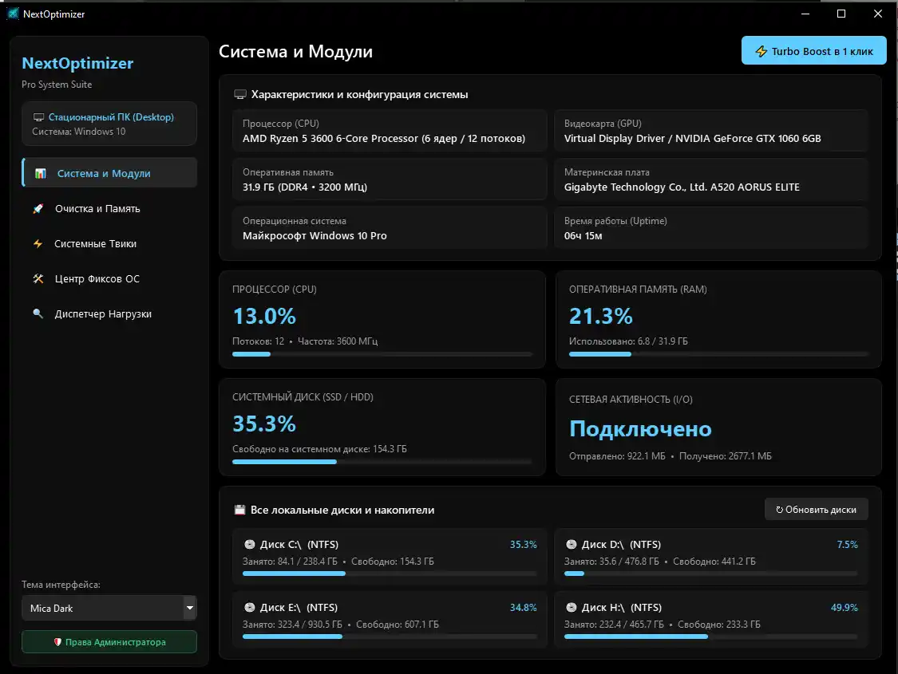
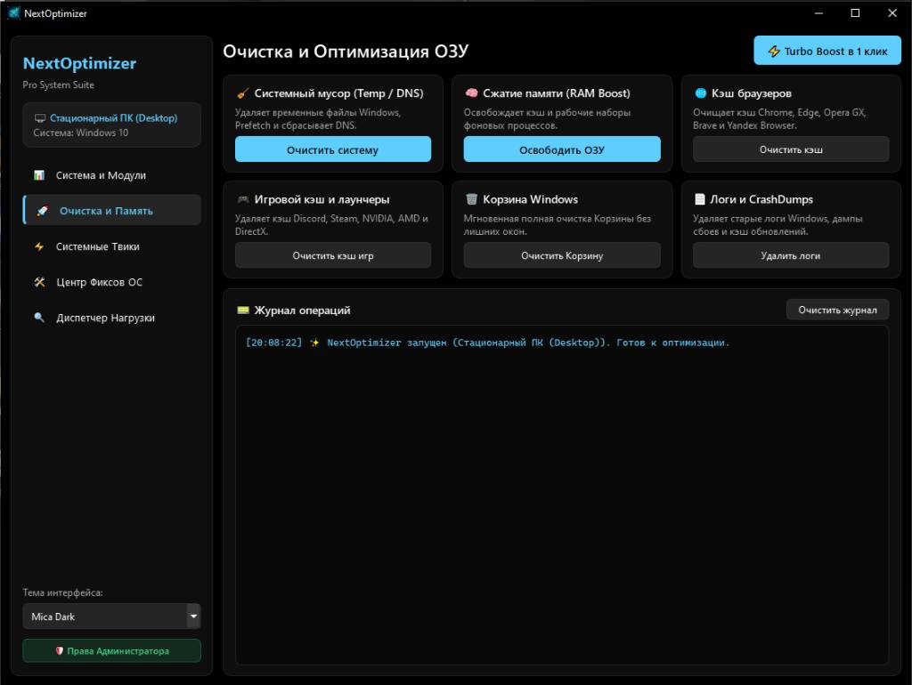
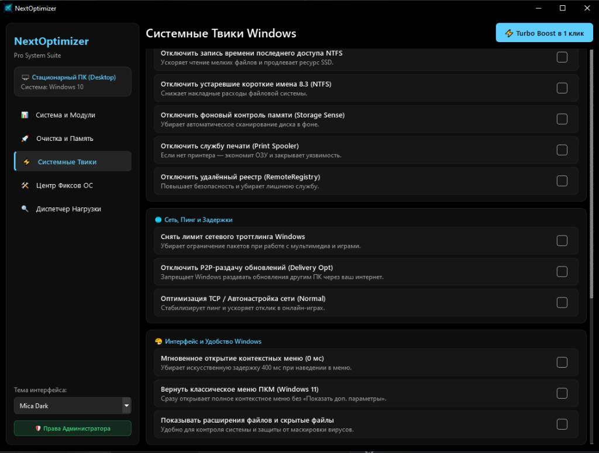
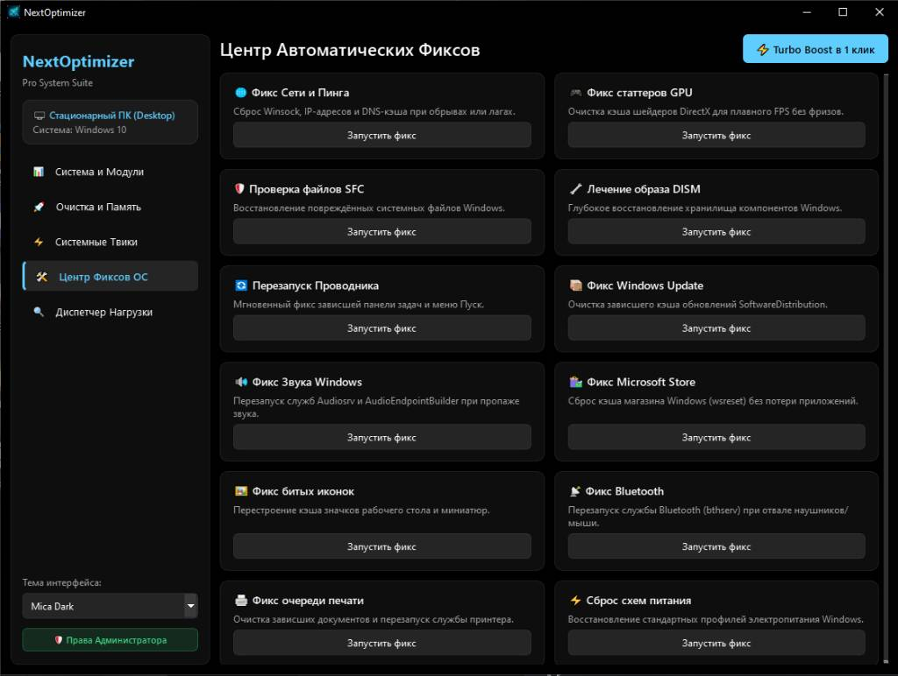

  

  <h1>⚡ NextOptimizer</h1>

  

    <strong>Мощная утилита нового поколения для оптимизации, очистки и диагностики ПК и ноутбуков на Windows</strong>
  

  

    
    
    
    
    
  

  

    <a href="#-возможности">Возможности</a> •
    <a href="#-скриншоты">Скриншоты</a> •
    <a href="#-binaries">Скачать</a> •
    <a href="#-темы-оформления">Темы</a>
  

---

## 🚀 О проекте

**NextOptimizer** — это быстрый и современный инструмент для настройки и ускорения Windows без рекламы, лишнего мусора и всплывающих окон консоли (`CMD`).

Интерфейс использует нативное аппаратное стекло **Windows DWM (Mica / Acrylic)**, благодаря чему окно работает плавно в **144+ FPS** и практически не нагружает процессор.

---

## 📥 Binaries

<table>
    <thead align="left">
        <tr>
            <th>OS</th>
            <th>Download</th>
        </tr>
    </thead>
    <tbody align="left">
        <tr>
            <td>Windows 10 / 11</td>
            <td>
                
            </td>
        </tr>
    </tbody>
</table>

> 💡 Приложение распространяется в виде одного портативного файла (**44.2 МБ**) — установка не требуется. Просто скачайте `NextOptimizer.exe` и запустите (права администратора запросятся автоматически).

---

## ✨ Возможности

| Модуль | Что умеет |
| :--- | :--- |
| 📊 **Мониторинг и Железо** | Полные характеристики ПК (CPU с ядрами/потоками, тип и частота ОЗУ DDR4/DDR5, GPU, материнская плата, ОС, живой Uptime) и отображение **всех локальных дисков**. |
| 💻 **Умный режим ПК / Ноутбук** | Автоматически определяет форм-фактор устройства: скрывает блок встроенной батареи на стационарном ПК и сканирует заряд беспроводных устройств (Bluetooth / HID). |
| 🧹 **Глубокая очистка и RAM Boost** | 6 модулей очистки: `Temp / Prefetch / DNS`, кэш браузеров (Chrome, Edge, Opera GX, Brave, Yandex), игровой кэш (Discord, Steam, NVIDIA/AMD/DirectX), Корзина, логи/CrashDumps и сжатие ОЗУ (`Working Set`). |
| ⚡ **30+ Системных твиков** | Разделены по 5 категориям: **Игры и FPS** (HAGS, Game Mode, Raw Mouse, MMCSS, Power Throttling), **Приватность и Телеметрия** (DiagTrack, Copilot, Bing), **Службы и SSD** (SysMain, WSearch, гибернация, NTFS), **Сеть и Пинг**, **Интерфейс Windows**. |
| 🛠️ **12 Авто-фиксов ОС** | Сброс сети (`Winsock / IP / DNS`), очистка кэша шейдеров DirectX, `SFC /scannow`, `DISM`, перезапуск Проводника, ремонт Windows Update, звука (`Audiosrv`), Microsoft Store, Bluetooth, битых иконок, очереди печати и схем питания. |
| 🔍 **Диспетчер нагрузки** | Отображает топ самых тяжёлых процессов в ОЗУ с возможностью мгновенного завершения. |

---

## 🎨 Темы оформления

Встроено **6 стильных тем** с мгновенным переключением и аппаратным размытием стекла:
* **Mica Dark** — классическое тёмное стекло с неоново-голубым акцентом
* **Acrylic Glass** — глубокий акрил с циановым свечением
* **Fluent Emerald** — изумрудная палитра
* **Fluent Amethyst** — фиолетовый аметист
* **Obsidian Gold** — премиальный чёрный с золотом
* **Crimson Carbon** — тёмный карбон с малиновым акцентом

---

## 📸 Скриншоты

  <table>
    <tr>
      <td align="center">
         
        <b>📊 Система, характеристики и все диски</b>
      </td>
      <td align="center">
         
        <b>🧹 Глубокая очистка и RAM Boost</b>
      </td>
    </tr>
    <tr>
      <td align="center">
         
        <b>⚡ 30+ Системных твиков</b>
      </td>
      <td align="center">
         
        <b>🛠️ 12 Автоматических фиксов Windows</b>
      </td>
    </tr>
  </table>

---

## ⚠️ Дисклеймер

> Некоторые системные твики и фиксы вносят изменения в реестр и службы Windows. Для полной функциональности требуется запуск от имени **Администратора**. Рекомендуется создать точку восстановления системы перед массовым применением твиков.

---

  Разработано для максимальной производительности Windows • <b>NextOptimizer v142.1.0</b>

